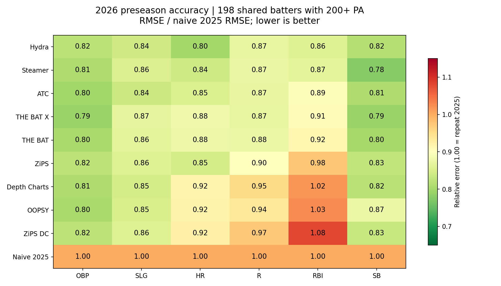

# 2026 preseason evaluation

[Read the analysis](evaluation_report.md), including the snapshot-timing caveat.
This compares the saved Hydra forecast with eight public systems and a repeat-2025
baseline. It does not retrain or change a production model.

The code is reusable for any season. See "Evaluate a new season" below.

## Verify from a clean checkout

After installing the project's dependencies (`uv sync`), run from the repo root:

```bash
uv run python scripts/evaluate_preseason.py --config configs/preseason_eval_2026.yaml --verify
```

This command needs no network, model checkpoints, or untracked source caches.
It recomputes every metric, playing-time metric, and paired bootstrap interval
from the committed player-level snapshots with scikit-learn. It also rebuilds the
cohorts and checks the FanGraphs/MLB actuals comparison. It does not modify files.

## Evidence

- [Player comparison](player_comparison.csv): all 243 Hydra players, matched
  actuals, each system's saved forecasts and projected PA, and cohort membership.
- [Earlier Hydra export](earlier_hydra.csv): the March 29 forecasts used only for
  the timing sensitivity check, keyed to the same player IDs.
- [FanGraphs actuals](actuals_2026_fangraphs.csv) and
  [MLB actuals](actuals_2026_mlb.csv): compact extracts from the October 29 download.
- [Per-target metrics](metrics_by_target.csv), [summaries](summary_metrics.csv),
  [playing time](playing_time_metrics.csv), and
  [paired bootstrap intervals](paired_bootstrap.csv).
- [Manifest](manifest.json): original source hashes, snapshot timestamps, code
  revision, seed and configuration. Original file modification dates do not prove
  an immutable pre-Opening-Day freeze.



## Rebuild 2026 from the original local caches

The full run needs every input in `configs/preseason_eval_2026.yaml`. Those bulk
caches stay untracked. Do not replace historical forecasts with fresh downloads,
because current public endpoints can return different forecasts.

```bash
uv run python scripts/evaluate_preseason.py --config configs/preseason_eval_2026.yaml
```

This rewrites the CSVs, plots, report and manifest in this folder, then runs the
verifier. To rebuild only the report text from the committed tables, add
`--report-only`.

## Evaluate a new season

1. Before Opening Day, save every forecast. Run `scripts/generate_projections.py`
   (the export now includes `idfg`, `mlbam_id` and projected PA) and
   `python -m src.data.fetch_projections --year <year>`.
2. After the season, fetch actuals with
   `python -m src.data.fetch_actuals --year <year>`. FanGraphs can block scripted
   requests. If it does, the command prints the URL to save by hand.
3. Copy `configs/preseason_eval_2026.yaml` to `preseason_eval_<year>.yaml`.
   Update `year`, `output_dir`, the input paths, and `notes`. Remove
   `legacy_id_match` and `hydra_alternate` if they do not apply.
4. Run `scripts/evaluate_preseason.py --config configs/preseason_eval_<year>.yaml`.

The findings text is generated from the result tables. Put season-specific
commentary in the config's `notes`.
