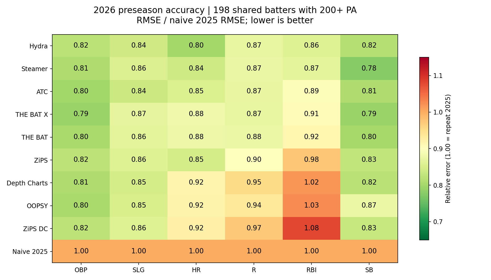
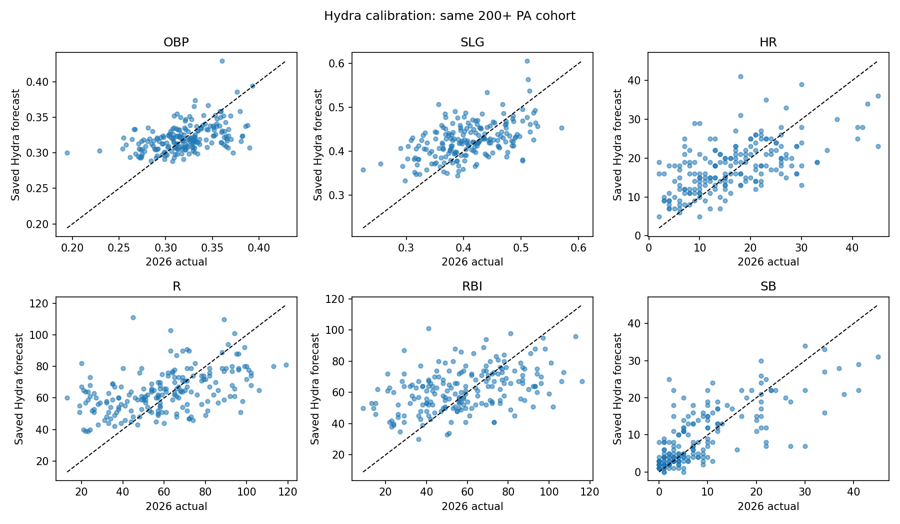
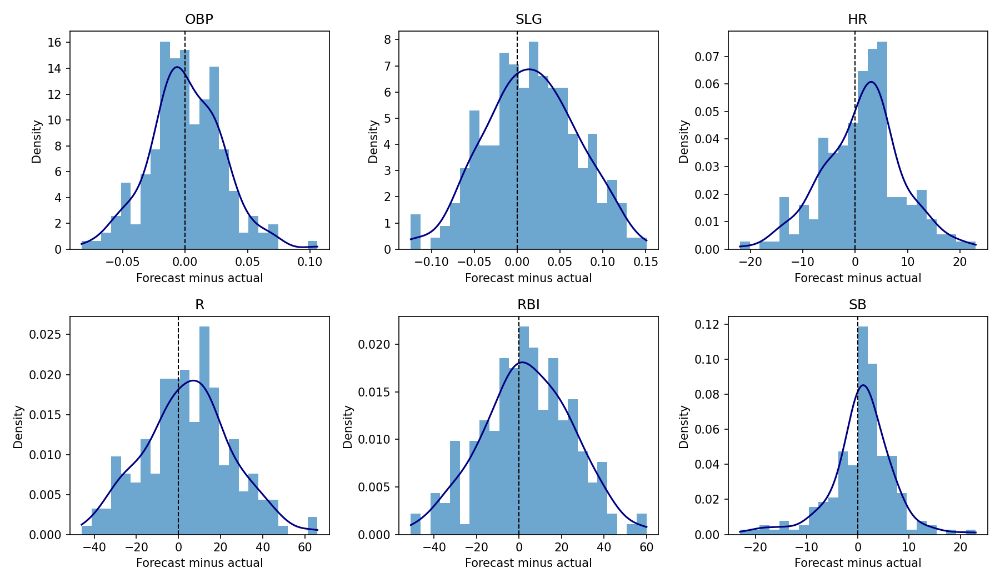
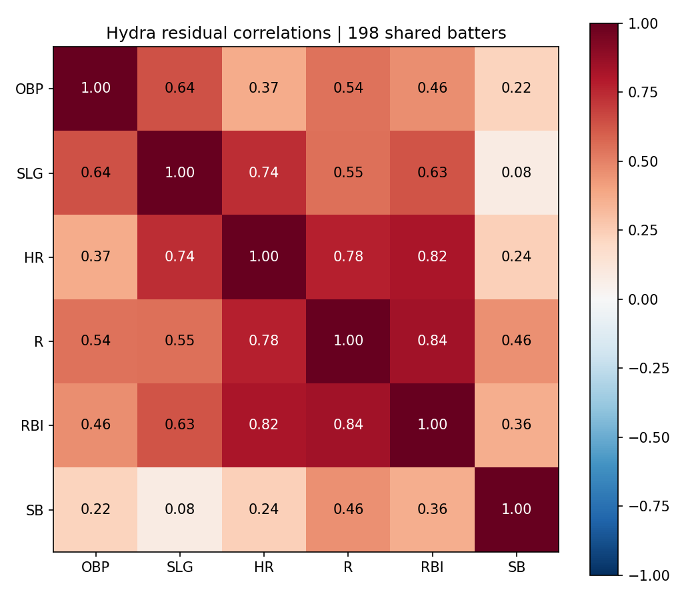

# Saved 2026 preseason forecasts vs 2026 regular-season actuals

Evaluated October 29, 2026. Hydra: 243 players; shared by all systems: 240; primary cohort (200+ actual PA): 198.

## Findings

Hydra ranks first on the existing 200+ PA benchmark: mean RMSE 9.418 versus Steamer 9.478 and ZiPS 10.124. Its equal-stat score is 0.8336 versus Steamer 0.8365; this small difference is not established by the paired bootstrap (Steamer minus Hydra 95% interval: -0.0280 to +0.0316). Hydra has the lowest HR, R and RBI RMSE; THE BAT X leads OBP, ATC leads SLG, and Steamer leads SB. All nine systems beat naive persistence on the aggregate score.

This is not an unconditional Hydra win. Including all 240 shared projected players in the counting-stat evaluation puts Steamer first, followed by ATC, THE BAT X, THE BAT, and Hydra fifth. Hydra's mean count RMSE is 16.486 versus Steamer 14.549 (13.3% higher). On all shared players, PA RMSE is 192.2 for Hydra versus 151.0 for Steamer; Hydra overpredicts PA by 77.1 per player on average. The per-PA diagnostic puts Hydra and ATC nearly level at the top. This points to availability/playing-time projection as a larger improvement opportunity than the underlying rate model; it does not by itself establish a causal error decomposition.

The conclusion is sensitive to the evaluation population: Steamer wins among all 234 shared batters with at least one PA, while ATC leads among the 100 with 500+ PA. The earlier March 29 Hydra export scores 9.437 mean RMSE and 0.8352 equal-stat score, leaving its narrow 200+ PA lead over Steamer intact. These are evaluations of saved forecasts with a timing caveat, not an independently proven Opening-Day freeze.

## Scope and provenance

The primary Hydra forecast is the saved projections_mtl_2026.csv export, dated April 12. Public CSVs are dated March 12. A different March 29 Hydra export is evaluated separately. File modification dates are evidence of local snapshots, not proof of immutable pre-Opening-Day forecasts. The available merged model inputs stop at 2025, but model-development timing cannot be independently established from these artifacts. No model was retrained and no forecasts were refreshed.

Hydra values retain their saved precision (3 decimals for OBP/SLG; integer counts); public exports retain original precision. IDs were recovered through exact name plus 2025 PA matches, then all comparisons use FanGraphs player IDs. Hydra projected PA is reconstructed using the existing temporal-feature and Marcel functions on the saved 2016–2025 merged frame. Its saved priors parquet contains different forecasts and is not substituted for the requested CSV.

Actuals are FanGraphs season=2026, season1=2026, qual=0, month=0 regular-season totals, all teams combined. All 1,472 returned records were retained. Independent MLB gameType=R season totals contain 751 players; all 751 match FanGraphs on all four target counts exactly and on OBP/SLG within 0.0005 rounding. PA differs by one for Ryan Jeffers and Sean Keys; this report consistently uses FanGraphs PA. FanGraphs' browser page returned HTTP 403; its data API succeeded.

No batting record in either complete source: Wilmer Flores, Jose Iglesias, Jurickson Profar, Michael A. Taylor, Mike Tauchman, Gavin Lux, Nolan Jones, Jordan Westburg. Their season counts and PA are zero; undefined rates are never scored as zero.

Excluded from the all-model intersection because a public system lacks a valid forecast: Jurickson Profar, Michael A. Taylor, Michael Toglia. Pairwise coverage checks are provided separately.

## Primary RMSE comparison

Every model is scored on identical players with at least 200 actual PA, consistent with the existing benchmark threshold. Lower RMSE is better. Equal-stat score is the mean of six target RMSEs divided by the corresponding naive-persistence RMSE; 1.00 means repeat 2025. This gives all targets equal influence. The repository's mixed-unit Mean RMSE is also retained, but is dominated by runs/RBI and should not be the sole overall ranking.

| model | OBP | SLG | HR | R | RBI | SB | Equal-stat score | Mean RMSE |
| --- | --- | --- | --- | --- | --- | --- | --- | --- |
| Hydra | 0.0293 | 0.0557 | 7.5431 | 21.1586 | 21.4535 | 6.2676 | 0.8336 | 9.4180 |
| Steamer | 0.0289 | 0.0569 | 7.9075 | 21.2556 | 21.6488 | 5.9705 | 0.8365 | 9.4780 |
| ATC | 0.0285 | 0.0555 | 8.0400 | 21.1992 | 22.3800 | 6.2141 | 0.8433 | 9.6529 |
| THE BAT X | 0.0283 | 0.0576 | 8.3113 | 21.1848 | 22.7070 | 6.0833 | 0.8517 | 9.7287 |
| THE BAT | 0.0286 | 0.0574 | 8.2714 | 21.3316 | 22.9004 | 6.1592 | 0.8562 | 9.7914 |
| ZiPS | 0.0294 | 0.0569 | 7.9810 | 21.8923 | 24.4261 | 6.3552 | 0.8715 | 10.1235 |
| Depth Charts | 0.0289 | 0.0562 | 8.6366 | 23.2091 | 25.4619 | 6.2913 | 0.8936 | 10.6140 |
| OOPSY | 0.0287 | 0.0564 | 8.6667 | 22.8118 | 25.6502 | 6.7244 | 0.9016 | 10.6564 |
| ZiPS DC | 0.0294 | 0.0569 | 8.6952 | 23.7031 | 27.0419 | 6.3948 | 0.9148 | 10.9869 |
| Naive 2025 | 0.0357 | 0.0664 | 9.4305 | 24.3468 | 25.0243 | 7.6874 | 1.0000 | 11.0985 |

## Other required metrics on the same primary cohort

MAE (lower is better):

| model | OBP | SLG | HR | R | RBI | SB |
| --- | --- | --- | --- | --- | --- | --- |
| Hydra | 0.0228 | 0.0450 | 5.9394 | 16.8485 | 17.0909 | 4.3535 |
| Steamer | 0.0226 | 0.0455 | 6.1883 | 17.0286 | 17.3798 | 4.1584 |
| ATC | 0.0222 | 0.0440 | 6.3384 | 16.8988 | 17.7339 | 4.4131 |
| THE BAT X | 0.0223 | 0.0458 | 6.4152 | 16.9528 | 17.8565 | 4.3440 |
| THE BAT | 0.0226 | 0.0453 | 6.4179 | 17.0982 | 18.1788 | 4.4170 |
| ZiPS | 0.0233 | 0.0451 | 6.1515 | 17.3838 | 19.3030 | 4.4596 |
| Depth Charts | 0.0227 | 0.0446 | 6.8030 | 18.7828 | 20.2677 | 4.4495 |
| OOPSY | 0.0224 | 0.0443 | 6.7576 | 18.7121 | 20.4697 | 4.8333 |
| ZiPS DC | 0.0233 | 0.0451 | 6.7172 | 19.1111 | 21.3636 | 4.4798 |
| Naive 2025 | 0.0282 | 0.0518 | 7.0960 | 18.8283 | 19.6212 | 5.2374 |

R² (higher is better; negative means worse than the cohort mean):

| model | OBP | SLG | HR | R | RBI | SB |
| --- | --- | --- | --- | --- | --- | --- |
| Hydra | 0.1989 | 0.1419 | 0.3131 | 0.1835 | 0.1121 | 0.5615 |
| Steamer | 0.2211 | 0.1067 | 0.2451 | 0.1760 | 0.0958 | 0.6021 |
| ATC | 0.2440 | 0.1480 | 0.2196 | 0.1804 | 0.0337 | 0.5690 |
| THE BAT X | 0.2528 | 0.0845 | 0.1660 | 0.1815 | 0.0053 | 0.5869 |
| THE BAT | 0.2336 | 0.0896 | 0.1740 | 0.1701 | -0.0118 | 0.5766 |
| ZiPS | 0.1941 | 0.1046 | 0.2310 | 0.1259 | -0.1511 | 0.5492 |
| Depth Charts | 0.2194 | 0.1274 | 0.0995 | 0.0176 | -0.2507 | 0.5582 |
| OOPSY | 0.2315 | 0.1202 | 0.0932 | 0.0510 | -0.2693 | 0.4953 |
| ZiPS DC | 0.1941 | 0.1046 | 0.0872 | -0.0246 | -0.4108 | 0.5436 |
| Naive 2025 | -0.1899 | -0.2170 | -0.0737 | -0.0810 | -0.2081 | 0.3404 |

MAPE, percent (zero actuals excluded; unstable for small count outcomes):

| model | OBP | SLG | HR | R | RBI | SB |
| --- | --- | --- | --- | --- | --- | --- |
| Hydra | 7.30 | 11.71 | 59.44 | 40.86 | 42.75 | 99.65 |
| Steamer | 7.33 | 11.96 | 56.74 | 37.49 | 39.39 | 96.31 |
| ATC | 7.11 | 11.31 | 59.32 | 40.40 | 43.52 | 110.23 |
| THE BAT X | 7.11 | 11.70 | 59.14 | 40.57 | 43.01 | 107.50 |
| THE BAT | 7.22 | 11.57 | 58.93 | 40.81 | 43.49 | 111.05 |
| ZiPS | 7.53 | 11.67 | 59.44 | 42.00 | 48.82 | 107.80 |
| Depth Charts | 7.35 | 11.65 | 66.39 | 45.66 | 50.65 | 111.81 |
| OOPSY | 7.24 | 11.45 | 64.10 | 45.75 | 50.19 | 126.48 |
| ZiPS DC | 7.53 | 11.67 | 63.36 | 46.07 | 53.00 | 109.56 |
| Naive 2025 | 8.97 | 13.16 | 66.32 | 43.72 | 46.61 | 132.51 |

## Robustness and playing time

The full-roster count evaluation includes low-PA and zero-PA players, avoiding the survivor filter in the primary table. The skill-only diagnostic divides each system's predicted counts by its own projected PA and actual counts by actual PA. Actual playing time is not substituted into season forecasts. Hydra's skill rates are approximate because the saved counts are rounded.

| cohort | model | n | mean_relative_rmse | mean_rmse | mean_mae | mean_r2 |
| --- | --- | --- | --- | --- | --- | --- |
| primary_200pa | Hydra | 198 | 0.8336 | 9.4180 | 7.3833 | 0.2518 |
| primary_200pa | Naive 2025 | 198 | 1.0000 | 11.0985 | 8.4771 | -0.0716 |
| primary_200pa | Steamer | 198 | 0.8365 | 9.4780 | 7.4705 | 0.2411 |
| primary_200pa | ZiPS | 198 | 0.8715 | 10.1235 | 7.8944 | 0.1756 |
| primary_200pa | THE BAT | 198 | 0.8562 | 9.7914 | 7.6966 | 0.2054 |
| primary_200pa | THE BAT X | 198 | 0.8517 | 9.7287 | 7.6061 | 0.2129 |
| primary_200pa | ATC | 198 | 0.8433 | 9.6529 | 7.5751 | 0.2324 |
| primary_200pa | Depth Charts | 198 | 0.8936 | 10.6140 | 8.3951 | 0.1285 |
| primary_200pa | ZiPS DC | 198 | 0.9148 | 10.9869 | 8.6234 | 0.0823 |
| primary_200pa | OOPSY | 198 | 0.9016 | 10.6564 | 8.4732 | 0.1203 |
| all_common_counts | Hydra | 240 | 0.8909 | 16.4860 | 13.1792 | 0.2967 |
| all_common_counts | Naive 2025 | 240 | 1.0000 | 17.9984 | 14.0948 | 0.1259 |
| all_common_counts | Steamer | 240 | 0.8029 | 14.5486 | 11.4897 | 0.4330 |
| all_common_counts | ZiPS | 240 | 0.9226 | 17.1187 | 13.6385 | 0.2426 |
| all_common_counts | THE BAT | 240 | 0.8482 | 15.3893 | 12.1607 | 0.3663 |
| all_common_counts | THE BAT X | 240 | 0.8454 | 15.3320 | 12.0796 | 0.3699 |
| all_common_counts | ATC | 240 | 0.8416 | 15.2526 | 12.0439 | 0.3780 |
| all_common_counts | Depth Charts | 240 | 0.9056 | 16.6284 | 13.1573 | 0.2725 |
| all_common_counts | ZiPS DC | 240 | 0.9281 | 17.1411 | 13.4521 | 0.2337 |
| all_common_counts | OOPSY | 240 | 0.9171 | 16.6787 | 13.2490 | 0.2608 |
| skill_per_pa_200pa | Hydra | 198 | 0.8212 | 0.0248 | 0.0196 | 0.2712 |
| skill_per_pa_200pa | Naive 2025 | 198 | 1.0000 | 0.0300 | 0.0232 | -0.0765 |
| skill_per_pa_200pa | Steamer | 198 | 0.8335 | 0.0252 | 0.0199 | 0.2449 |
| skill_per_pa_200pa | ZiPS | 198 | 0.8641 | 0.0261 | 0.0205 | 0.1743 |
| skill_per_pa_200pa | THE BAT | 198 | 0.8402 | 0.0254 | 0.0200 | 0.2326 |
| skill_per_pa_200pa | THE BAT X | 198 | 0.8338 | 0.0252 | 0.0200 | 0.2450 |
| skill_per_pa_200pa | ATC | 198 | 0.8220 | 0.0248 | 0.0195 | 0.2707 |
| skill_per_pa_200pa | Depth Charts | 198 | 0.8368 | 0.0253 | 0.0199 | 0.2353 |
| skill_per_pa_200pa | ZiPS DC | 198 | 0.8654 | 0.0261 | 0.0205 | 0.1722 |
| skill_per_pa_200pa | OOPSY | 198 | 0.8479 | 0.0255 | 0.0200 | 0.2203 |
| sensitivity_1pa | Hydra | 234 | 0.8840 | 10.7359 | 8.5614 | 0.2472 |
| sensitivity_1pa | Naive 2025 | 234 | 1.0000 | 11.8117 | 9.2212 | 0.0447 |
| sensitivity_1pa | Steamer | 234 | 0.8335 | 9.6528 | 7.6244 | 0.3262 |
| sensitivity_1pa | ZiPS | 234 | 0.9045 | 11.1438 | 8.8691 | 0.2121 |
| sensitivity_1pa | THE BAT | 234 | 0.8538 | 10.2005 | 8.0494 | 0.2989 |
| sensitivity_1pa | THE BAT X | 234 | 0.8563 | 10.1681 | 7.9975 | 0.2930 |
| sensitivity_1pa | ATC | 234 | 0.8509 | 10.1052 | 7.9690 | 0.3046 |
| sensitivity_1pa | Depth Charts | 234 | 0.9004 | 11.0309 | 8.7329 | 0.2199 |
| sensitivity_1pa | ZiPS DC | 234 | 0.9175 | 11.3683 | 8.9282 | 0.1893 |
| sensitivity_1pa | OOPSY | 234 | 0.9047 | 11.0678 | 8.8003 | 0.2187 |
| sensitivity_500pa | Hydra | 100 | 0.8568 | 8.7464 | 6.8312 | 0.0456 |
| sensitivity_500pa | Naive 2025 | 100 | 1.0000 | 10.3227 | 7.9798 | -0.3378 |
| sensitivity_500pa | Steamer | 100 | 0.8921 | 9.6628 | 7.5354 | -0.0801 |
| sensitivity_500pa | ZiPS | 100 | 0.8587 | 8.9375 | 6.9362 | 0.0271 |
| sensitivity_500pa | THE BAT | 100 | 0.8594 | 8.9161 | 6.9977 | 0.0079 |
| sensitivity_500pa | THE BAT X | 100 | 0.8526 | 8.7479 | 6.8443 | 0.0330 |
| sensitivity_500pa | ATC | 100 | 0.8399 | 8.6624 | 6.7648 | 0.0674 |
| sensitivity_500pa | Depth Charts | 100 | 0.8610 | 9.1217 | 7.1410 | 0.0057 |
| sensitivity_500pa | ZiPS DC | 100 | 0.8861 | 9.5123 | 7.4245 | -0.0643 |
| sensitivity_500pa | OOPSY | 100 | 0.8648 | 9.1434 | 7.2209 | -0.0004 |
| earlier_hydra_export_200pa | Hydra | 198 | 0.8352 | 9.4372 | 7.3960 | 0.2490 |
| earlier_hydra_export_200pa | Naive 2025 | 198 | 1.0000 | 11.0985 | 8.4771 | -0.0716 |
| earlier_hydra_export_200pa | Steamer | 198 | 0.8365 | 9.4780 | 7.4705 | 0.2411 |
| earlier_hydra_export_200pa | ZiPS | 198 | 0.8715 | 10.1235 | 7.8944 | 0.1756 |
| earlier_hydra_export_200pa | THE BAT | 198 | 0.8562 | 9.7914 | 7.6966 | 0.2054 |
| earlier_hydra_export_200pa | THE BAT X | 198 | 0.8517 | 9.7287 | 7.6061 | 0.2129 |
| earlier_hydra_export_200pa | ATC | 198 | 0.8433 | 9.6529 | 7.5751 | 0.2324 |
| earlier_hydra_export_200pa | Depth Charts | 198 | 0.8936 | 10.6140 | 8.3951 | 0.1285 |
| earlier_hydra_export_200pa | ZiPS DC | 198 | 0.9148 | 10.9869 | 8.6234 | 0.0823 |
| earlier_hydra_export_200pa | OOPSY | 198 | 0.9016 | 10.6564 | 8.4732 | 0.1203 |

## Paired uncertainty versus Hydra

2,000 paired player bootstrap samples per cohort, seed 42. Delta is other model score minus Hydra score, using that cohort's fixed naive-RMSE normalization. Positive means Hydra is better. An interval crossing zero does not establish a difference; intervals are exploratory and not adjusted for multiple comparisons.

| cohort | model | delta_model_minus_hydra | ci95_low | ci95_high |
| --- | --- | --- | --- | --- |
| primary_200pa | Naive 2025 | 0.1664 | 0.1094 | 0.2269 |
| primary_200pa | Steamer | 0.0029 | -0.0280 | 0.0316 |
| primary_200pa | ZiPS | 0.0379 | 0.0107 | 0.0688 |
| primary_200pa | THE BAT | 0.0225 | -0.0125 | 0.0560 |
| primary_200pa | THE BAT X | 0.0180 | -0.0150 | 0.0500 |
| primary_200pa | ATC | 0.0097 | -0.0208 | 0.0393 |
| primary_200pa | Depth Charts | 0.0600 | 0.0235 | 0.0975 |
| primary_200pa | ZiPS DC | 0.0812 | 0.0412 | 0.1226 |
| primary_200pa | OOPSY | 0.0680 | 0.0300 | 0.1063 |
| all_common_counts | Naive 2025 | 0.1091 | 0.0542 | 0.1631 |
| all_common_counts | Steamer | -0.0880 | -0.1355 | -0.0468 |
| all_common_counts | ZiPS | 0.0317 | 0.0003 | 0.0632 |
| all_common_counts | THE BAT | -0.0427 | -0.0860 | -0.0028 |
| all_common_counts | THE BAT X | -0.0455 | -0.0880 | -0.0064 |
| all_common_counts | ATC | -0.0493 | -0.0907 | -0.0109 |
| all_common_counts | Depth Charts | 0.0147 | -0.0350 | 0.0635 |
| all_common_counts | ZiPS DC | 0.0372 | -0.0170 | 0.0910 |
| all_common_counts | OOPSY | 0.0262 | -0.0265 | 0.0753 |
| skill_per_pa_200pa | Naive 2025 | 0.1788 | 0.1237 | 0.2337 |
| skill_per_pa_200pa | Steamer | 0.0124 | -0.0121 | 0.0366 |
| skill_per_pa_200pa | ZiPS | 0.0429 | 0.0154 | 0.0724 |
| skill_per_pa_200pa | THE BAT | 0.0190 | -0.0132 | 0.0497 |
| skill_per_pa_200pa | THE BAT X | 0.0127 | -0.0163 | 0.0411 |
| skill_per_pa_200pa | ATC | 0.0008 | -0.0240 | 0.0248 |
| skill_per_pa_200pa | Depth Charts | 0.0156 | -0.0069 | 0.0395 |
| skill_per_pa_200pa | ZiPS DC | 0.0443 | 0.0169 | 0.0736 |
| skill_per_pa_200pa | OOPSY | 0.0268 | -0.0001 | 0.0539 |

## Coverage

| Model | Saved players | Hydra overlap | Overlap >=200 PA | Missing Hydra players |
| --- | --- | --- | --- | --- |
| Hydra | 243 | 243 | 198 |  |
| Naive 2025 | 243 | 243 | 198 |  |
| Steamer | 978 | 242 | 198 | Michael A. Taylor |
| ZiPS | 781 | 243 | 198 |  |
| THE BAT | 617 | 242 | 198 | Michael A. Taylor |
| THE BAT X | 617 | 242 | 198 | Michael A. Taylor |
| ATC | 579 | 242 | 198 | Michael A. Taylor |
| Depth Charts | 568 | 240 | 198 | Jurickson Profar; Michael A. Taylor; Michael Toglia |
| ZiPS DC | 568 | 240 | 198 | Jurickson Profar; Michael A. Taylor; Michael Toglia |
| OOPSY | 771 | 242 | 198 | Jurickson Profar |

## Files and metric definitions

metrics_by_target.csv contains RMSE, MAE, R², MAPE, signed bias, valid MAPE denominator counts, and normalized error for every target/cohort/model. MAPE excludes zero actuals, so count-stat MAPE, especially steals, is supplementary. summary_metrics.csv contains means. player_comparison.csv contains every input forecast and matched actual; playing_time_metrics.csv isolates PA errors. Accuracy, calibration and residual plots are included. Training curves are not regenerated because this is a frozen-forecast evaluation. manifest.json records every input hash, code version, config and seed. Reproduce from repository root with `.venv/bin/python data/reports/preseason_2026/evaluate.py`.

## Reproduction and charts

See [verification instructions and source requirements](README.md). The offline verifier reproduces the numerical results from committed snapshots; rebuilding with evaluate.py requires the original local caches.

